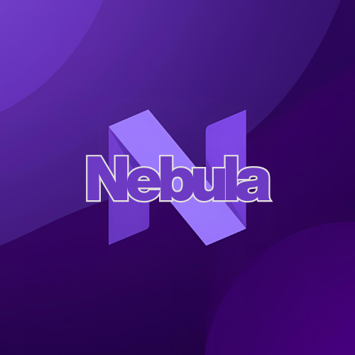

# Nebula:KB - DEV (archived)

> [!IMPORTANT]
> This repository is archived and no longer maintained.

Nebula.KB-dev was a copy of [Nebula.KB](https://github.com/gioxx/Nebula.KB) that documented the development versions of the Nebula modules, before their release on the PowerShell Gallery. Keeping two copies of the same documentation in sync was no longer worth it.

The documentation now lives in a single site, **[kb.gioxx.org](https://kb.gioxx.org)**, where each module has two versions:

- **Stable**: the version published on the PowerShell Gallery (default).
- **Next**: the version in development, under `/Nebula/<Module>/next/`.

Read the [announcement](https://kb.gioxx.org/news/versioned-documentation) for details.
